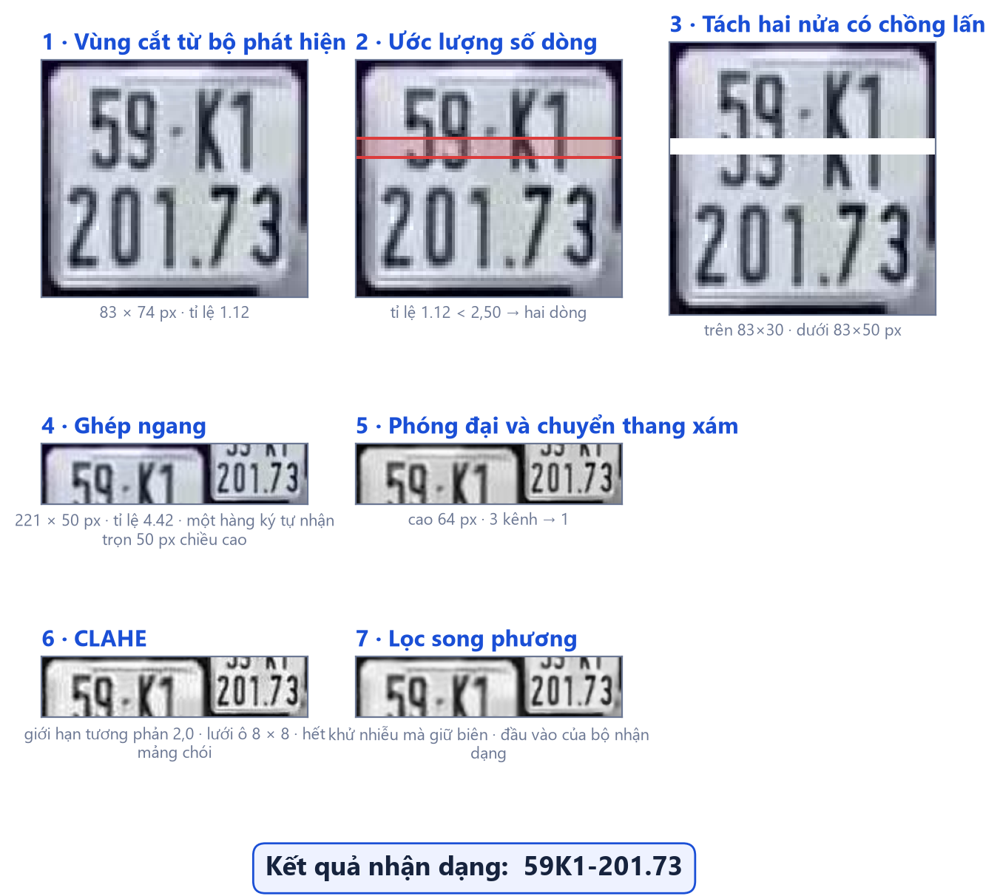
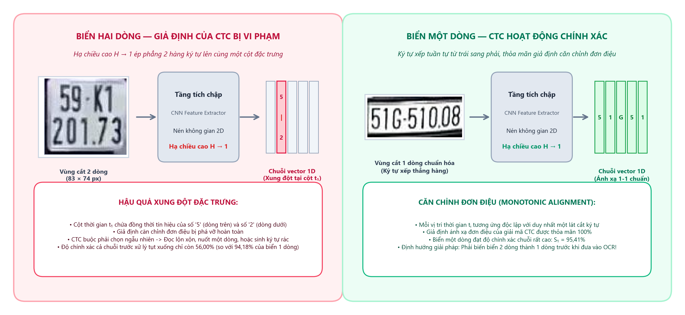
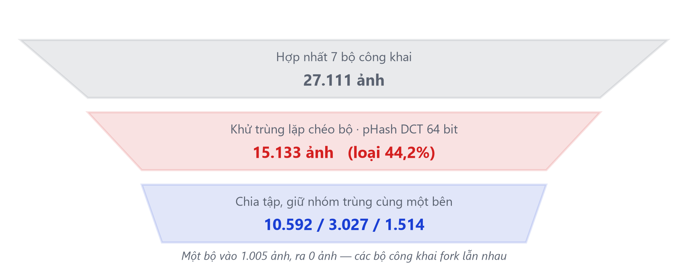
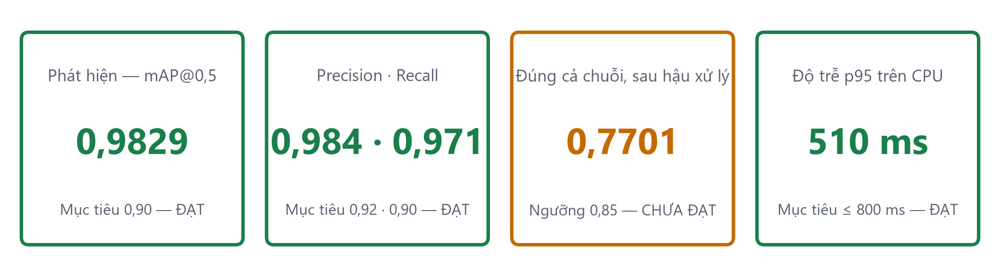
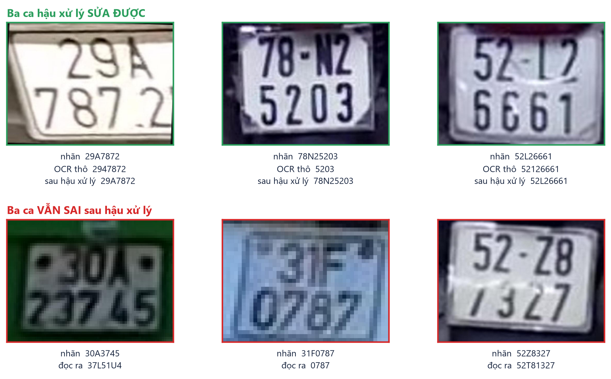
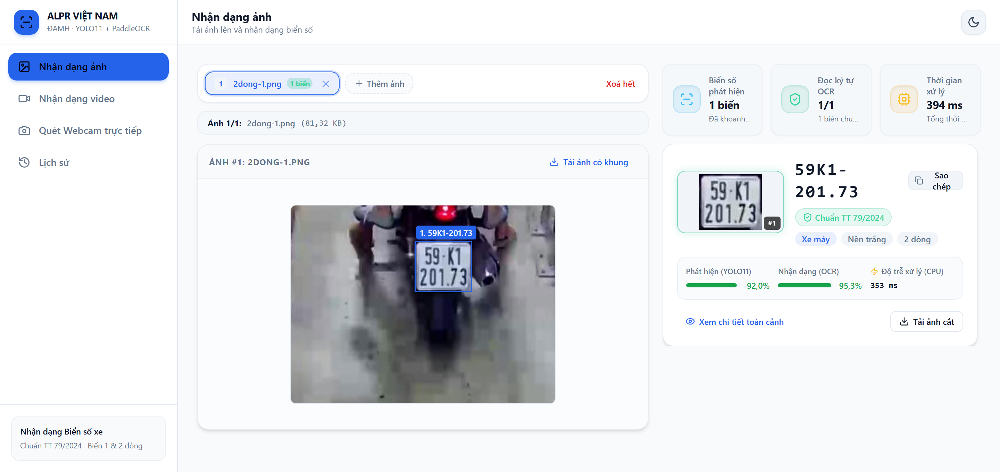

<!--
BỘ SLIDE ĐỒ ÁN MÔN HỌC — bám sát rubric thuyết trình của giảng viên.

Cấu trúc theo rubric:
  1. Bài toán (I/O công thức toán → Ý nghĩa + Thách thức → Khảo sát phương pháp)
  2. Phương pháp đề xuất (Overview framework → Chi tiết)
  3. Thực nghiệm (Dataset → Metric → Kết quả → Ví dụ → Ablation)
  4. Kết luận & Hướng phát triển

BỐN QUY ƯỚC BẮT BUỘC — vi phạm là vỡ layout:
1. Chỉ dùng `##`. Mỗi `##` là một slide.
2. Bảng hoặc hình phải là khối CUỐI CÙNG của slide, chỉ được MỘT.
3. Câu dẫn trên bảng/hình: tối đa ~100 ký tự.
4. Mọi con số phải truy được về `docs/reports/` hoặc `docs/papers/mon-hoc/`.

Kiểm tra sau mỗi lần sửa:
  python scripts/build_thesis.py --slides docs/slides/12-slides-mon-hoc.md
  powershell -File scripts/check_slides.ps1 -DeckPath docs/slides/12-slides-mon-hoc.pptx
-->

## Nội dung trình bày

1. Bài toán
2. Phương pháp đề xuất
3. Thực nghiệm
4. Kết luận và hướng phát triển

## Định nghĩa bài toán

Với ảnh phương tiện $I \in \mathbb{R}^{H \times W \times 3}$, hệ thống học hàm:

$$f_{\theta}(I) = (b,\; y,\; c)$$

- $b$: hộp bao biển số
- $y \in \Sigma^n$: chuỗi 7–9 ký tự
- $c$: nhãn màu nền biển
- Ràng buộc vận hành: p95 ≤ **1,5 giây**

## Phạm vi đề tài

| Trong phạm vi | Ngoài phạm vi |
|---|---|
| Phát hiện biển số trên ảnh | Theo dõi phương tiện qua nhiều khung hình |
| Nhận dạng biển một dòng và hai dòng | Điều khiển barie hoặc thiết bị ngoại vi |
| Chuẩn hóa chuỗi và nhận dạng màu nền | Kiến trúc microservices hoặc multi-GPU |
| Tối ưu suy luận trên máy tính phổ thông | Nhận dạng khuôn mặt và danh tính chủ xe |

## Ý nghĩa thực tiễn

- Tự động hóa khâu nhập biển số từ camera hoặc ảnh tĩnh
- Làm lõi nhận dạng cho bãi đỗ xe, thu phí và kiểm soát ra vào
- Có thể triển khai trên máy tính phổ thông
- Đánh giá bằng **đúng cả chuỗi**, sát với yêu cầu vận hành thực tế

## Thách thức của bài toán

- **77 triệu xe máy** khiến biển hai dòng là trường hợp phổ biến
- CRNN/CTC chuẩn hóa ảnh thành một chuỗi ngang, khó bảo toàn bố cục hai dòng
- Biển xe máy **190 × 140 mm** là đối tượng nhỏ trong khung hình
- Chói phản quang, bụi bẩn, nhòe và góc nghiêng làm mất nét ký tự

## Các hướng tiếp cận hiện có

Đề tài chọn hướng 4 vì không cần huấn luyện lại OCR và phù hợp khi triển khai.

| Hướng tiếp cận | Nhận dạng | Hạn chế với biển VN |
|---|---|---|
| Truyền thống: morphology + SVM | SVM/CNN ký tự | Nhạy với góc nghiêng và nhiễu |
| YOLO + OCR dựng sẵn | EasyOCR/Tesseract | Suy giảm mạnh trên biển hai dòng |
| End-to-end | LPRNet/CRNN | Cần dữ liệu Việt Nam để huấn luyện lại |
| **Phương pháp của đề tài** | **YOLO11n + PP-OCRv5** | Thêm biến đổi ảnh, phù hợp máy tính phổ thông |

## Pipeline đề xuất

Đóng góp cốt lõi nằm ở **khối xử lý ảnh** giữa hai mô hình học sâu.

## Tại sao OCR đọc sai biển hai dòng?

Feature map nén H → 1 khiến ký tự hai hàng chồng cột — CTC xung đột và đọc sai.

## Khối xử lý ảnh

Tái cấu trúc hình học ảnh để khớp với giả định đầu vào của CRNN/CTC sẵn có.

| Phép xử lý | Mục đích | Thay cho |
|---|---|---|
| **Ngưỡng tỉ lệ AR = 2,50** | Phân loại 1 dòng / 2 dòng | Huấn luyện bộ phân loại |
| **Tách & ghép ngang** | Biến 2 dòng thành 1 dòng | Mô hình đọc đa dòng |
| **CLAHE** | Xử lý chói cục bộ | Cân bằng histogram toàn cục |
| **Lọc song phương** | Khử nhiễu giữ biên | Làm mờ Gauss |
| **Nắn phẳng (Deskew)** | Hiệu chỉnh biển nghiêng | Homography 3D (quá chậm) |

## Bộ luật hậu xử lý theo vị trí

Khai thác đặc trưng cấu trúc biển số Việt Nam để sửa lỗi OCR theo từng vị trí ký tự.

| Ràng buộc | Nội dung |
|---|---|
| Mã tỉnh | 81/89 giá trị hợp lệ |
| Mặt nạ vị trí | DDLDDDDD · DDL?DDDDD |
| Ánh xạ nhầm lẫn | O→0 hợp lý; 0→O không bao giờ |

## Bộ dữ liệu

7 bộ công khai, 27.111 ảnh → khử 44,2% trùng lặp → **15.133 ảnh**, chia 70 / 20 / 10.

## Phương pháp đánh giá

- **mAP@0,5:** dự đoán đúng khi IoU ≥ 0,5
- **Precision, Recall:** mức báo nhầm và bỏ sót của bộ phát hiện
- **S₀, S₁:** đúng cả chuỗi trước và sau hậu xử lý
- **CER:** tỉ lệ ký tự sai
- **p50, p95, p99:** phân vị độ trễ đầu cuối

## Kết quả

Bộ phát hiện đạt cả 4 chỉ tiêu; phần thiếu tập trung hoàn toàn ở biển hai dòng.

## Ví dụ: ca đúng và ca sai

Ba ca được hậu xử lý cứu; ba ca vẫn sai — **lỗi đều ở dòng trên của biển hai dòng**.

## Đóng góp của từng bước (Ablation)

Chi phí của tách–ghép chưa được tách thành một phép đo độc lập.

| Can thiệp | Mức cải thiện (+Δ metric) | Chi phí tính toán (+ms trễ) |
|---|---:|---:|
| Tách–ghép ngang + PP-OCRv5 | **+34,92 điểm S₀** | Chưa đo tách riêng |
| Hậu xử lý theo vị trí | **+13,28 điểm S₁** | **+0,03 ms** |
| Thử lại có nắn phẳng | **+34 biển đúng** | **+276,80 ms p95** |

## Demo: hệ thống chạy thật

Khởi động bằng một lệnh docker compose up; giao diện hiển thị chuỗi thô và chuỗi đã chuẩn hóa.

## Kết luận

- Phát hiện mAP@0,5 = **0,9829** · Biển một dòng S₁ = **0,9541**
- Biến đổi hình học biển hai dòng: **+34,92 điểm** · Hậu xử lý: **+13,28 điểm**, 0 ca sai lệch
- Độ trễ đầu cuối đạt p95 = **509,76 ms**
- Điểm nghẽn còn lại là biển hai dòng, S₁ = **0,7234**

## Hạn chế và hướng phát triển

| Hạn chế đã đo | Hướng phát triển |
|---|---|
| Biển hai dòng S₁ = **0,7234** | Huấn luyện recognizer chuyên biệt cho biển Việt Nam |
| Bảng nhầm lẫn còn hạn chế | Mở rộng từ ma trận nhầm lẫn trên dữ liệu mới |
| Tập test chưa xuyên nguồn dữ liệu | Bổ sung phép đánh giá chéo theo nguồn |

## Cảm ơn & Hỏi đáp (Q&A)

**Đề tài: Xây dựng hệ thống nhận diện biển số xe bằng Trí tuệ nhân tạo**

- **Giảng viên hướng dẫn:** ThS. Cáp Phạm Đình Thăng
- **Sinh viên thực hiện:** Phạm Nguyễn Thế Châu | Nguyễn Công Hậu | Nguyễn Minh Hiếu | Phạm Công Thành

**Xin trân trọng cảm ơn Quý Thầy/Cô và các bạn!**

**Phiên trao đổi & Hỏi đáp (Q&A)**
